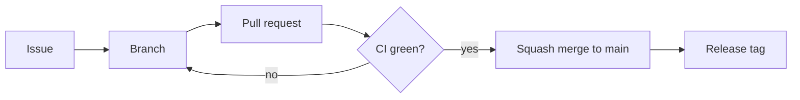

# Contributing to keepstack

Thanks for helping! keepstack is small on purpose: one dependency-free Python module, a Dockerfile and a test suite
that runs real Terraform against a real emulator. Please keep changes in that spirit.

## Development setup

Requirements: Python 3.10+, Docker and Terraform 1.5+.

```sh
git clone https://github.com/sanlega/keepstack && cd keepstack
python -m venv .venv && . .venv/bin/activate     # Windows: .venv\Scripts\activate
pip install -e .
keepstack --version
```

## Project layout

| Path | Contents |
|---|---|
| `src/keepstack/proxy.py` | The engine: proxy, write-ahead journal, replay and ID translation |
| `src/keepstack/cli.py` | Command line: argument parsing, `up` and `env`, wiring for every other command |
| `src/keepstack/daemon.py` | `up -d`, `down`, `status`, `logs` |
| `src/keepstack/check.py`, `compat.json` | `check` and the machine-readable compatibility matrix |
| `src/keepstack/validate.py` | `validate`: apply on keepstack and classify failures |
| `src/keepstack/doctor.py` | `doctor` |
| `src/keepstack/snapshot.py`, `compact.py` | Snapshots, `export`/`import`, `compact` |
| `src/keepstack/shims.py` | Opt-in emulator workarounds (`--shims`) |
| `src/keepstack/dashboard.py`, `dashboard.html` | `ui` and the read-only web dashboard |
| `action.yml` | The GitHub Action (tested by `.github/workflows/action.yml`) |
| `src/keepstack/Dockerfile` | Emulator image, built automatically on first `keepstack up` |
| `examples/quickstart/` | Terraform example used in the README and by the end-to-end tests |
| `tests/test_*.py` | Fast unit tests, one file per module |
| `tests/test_e2e*.py` | Real Docker (+ Terraform) end-to-end suites: persistence, background mode, compaction, shims |
| `tests/compat/` | Terraform configurations behind the [compatibility matrix](docs/compatibility.md) |
| `docs/` | Design notes, compatibility matrix, translations and logo |

## Running the tests

```sh
scripts/verify            # macOS / Linux
scripts/verify.ps1        # Windows
```

This runs the unit tests and the end-to-end suite (about one minute). The end-to-end tests are skipped if Docker or
Terraform are missing. Useful variables:

| Variable | Purpose |
|---|---|
| `TERRAFORM` | Path to a specific Terraform binary (default: `terraform` on `PATH`) |
| `KEEPSTACK_E2E_PORT` | Port for the main end-to-end run (default `9340`; the emulator uses the next one). The other suites use 9350, 9360 and 9380 (`KEEPSTACK_E2E_DAEMON_PORT`, `KEEPSTACK_E2E_COMPACT_PORT`, `KEEPSTACK_E2E_SHIMS_PORT`, 9390 for the dashboard, 9420-9423 for `validate`, `KEEPSTACK_E2E_VALIDATE_PORT`, and 9470 for crash safety, `KEEPSTACK_E2E_CRASH_PORT`) |
| `TF_PLUGIN_CACHE_DIR` | Reuse downloaded providers between runs |

Unit tests only (no Docker): `PYTHONPATH=src python -m unittest tests.test_unit tests.test_check tests.test_doctor tests.test_daemon tests.test_snapshot tests.test_compact tests.test_shims tests.test_dashboard tests.test_validate`.

## Workflow

Work is planned in the open on the [roadmap board](https://github.com/users/sanlega/projects/3) and in
[milestones](https://github.com/sanlega/keepstack/milestones).



1. **Issue first.** Every change starts from an issue with a `type:` label, an `area:` label and a priority.
   Larger features are grouped under an `epic` issue with sub-issues; spikes are time-boxed investigations.
2. **Branch** from `main` as `<type>/<issue>-<short-slug>`, for example `feat/9-validate-command`,
   `fix/21-replay-timeout`, `docs/30-cdk-guide`, `chore/7-project-workflow`.
3. **Commits** follow [Conventional Commits](https://www.conventionalcommits.org/): `feat(validate): ...`,
   `fix(proxy): ...`, `docs: ...`, `test: ...`, `ci: ...`, `chore: ...`.
4. **Pull request** titled like a commit and starting with `Closes #<issue>`. `main` is protected: it only accepts
   pull requests, and lint, unit tests (Linux, macOS, Windows), end-to-end tests and the Action workflow must pass.
5. **Squash merge**, so `main` keeps one commit per pull request; the branch is deleted on merge.

Board columns: **Backlog** (accepted, not scheduled), **Ready** (in a milestone), **In progress** (a branch
exists), **In review** (PR open), **Done** (merged).

| Label | Meaning |
|---|---|
| `type: feature` / `bug` / `docs` / `chore` / `spike` | Kind of work |
| `area: proxy` / `cli` / `validate` / `check` / `action` / `dashboard` | Part of the code base |
| `priority: high` / `medium` / `low` | Order within a milestone |
| `epic` | Groups sub-issues |
| `discussion` | Needs a decision before work starts |
| `backlog` | Accepted, not scheduled for a release |

## Releasing

1. Move the *Unreleased* entries in `CHANGELOG.md` under a new `## [x.y.z] - YYYY-MM-DD` heading and update the links.
2. Refresh the bundled emulator fidelity data: `python scripts/update_fidelity.py`.
3. Set `__version__` in `src/keepstack/__init__.py` to the same version and merge to `main`.
4. Tag and push: `git tag vX.Y.Z && git push origin vX.Y.Z`.

The [release workflow](.github/workflows/release.yml) checks that the tag matches the version, builds and tests the
wheel, publishes it to PyPI through trusted publishing and creates the GitHub release with the changelog notes.
GitHub Action users pin `sanlega/keepstack@vX.Y.Z`.

## Pull requests

- Keep the standard-library-only rule: no runtime dependencies.
- Add a test for every behaviour change. Bugs in replay or ID translation need a unit test that reproduces them.
- New resource types for the compatibility matrix: add them to a group in `tests/compat/`, run the full cycle
  described in [docs/compatibility.md](docs/compatibility.md) and update the table.
- If something fails **without** keepstack too, it is an emulator issue: report it to
  [aws/aws-emulator](https://github.com/aws/aws-emulator) and document it in the compatibility matrix.
- Update [CHANGELOG.md](CHANGELOG.md) under *Unreleased*.
- CI must be green (lint, unit tests on Linux/macOS/Windows, end-to-end on Linux).
