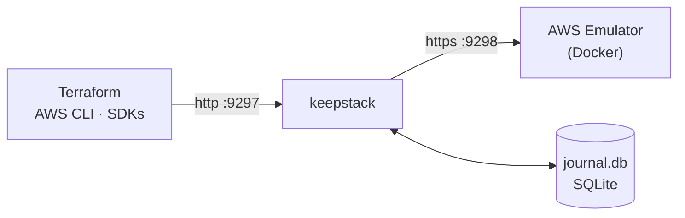

<p align="center">
  <picture>
    <source media="(prefers-color-scheme: dark)" srcset="docs/assets/keepstack-logo-white.svg">
    
  </picture>
</p>

<h3 align="center">Test your Terraform on local AWS before it touches the real one.</h3>

<p align="center">
  keepstack gives the official <a href="https://docs.aws.amazon.com/emulator/latest/userguide/what-is-service.html">AWS Emulator</a> a memory.
  Your local infrastructure survives restarts with the same IDs, and every pull request is applied on top of what
  <code>main</code> already built. No AWS account, no tokens.
</p>

<p align="center">
  <a href="https://github.com/sanlega/keepstack/actions/workflows/ci.yml"></a>
  <a href="LICENSE"></a>
  
  
</p>

<p align="center">
  <a href="#quick-start">Quick start</a> ·
  <a href="#validate-pull-requests">Validate pull requests</a> ·
  <a href="docs/how-it-works.md">How it works</a> ·
  <a href="docs/compatibility.md">Compatibility</a> ·
  <a href="CONTRIBUTING.md">Contributing</a>
  <br>
  <sub><strong>English</strong> · <a href="docs/i18n/README.es.md">Español</a> · <a href="docs/i18n/README.zh-CN.md">简体中文</a></sub>
</p>

<br>

## Two ways to use it

<table>
<tr>
<th width="50%">💻 On your machine</th>
<th width="50%">🔁 In every pull request</th>
</tr>
<tr>
<td>

The official AWS Emulator, with a memory. Apply, reboot, come back days later: `terraform plan` still says
*No changes*, with the same VPC IDs, ARNs and data. Add one resource and the plan shows exactly that one.

**→ [Quick start](#quick-start)**

</td>
<td>

One step in GitHub Actions applies the pull request on top of the environment `main` already built and comments the
incremental plan and every problem on the PR: config errors, emulator gaps, non-idempotent resources.

**→ [Validate pull requests](#validate-pull-requests)**

</td>
</tr>
</table>

## The problem

AWS Emulator is AWS's official local emulator: fast and faithful, but **everything lives in memory**.

<table>
<tr>
<th width="50%">😩 Without keepstack</th>
<th width="50%">😌 With keepstack</th>
</tr>
<tr>
<td>

```console
$ terraform apply      # 30 resources
$ # ...reboot...
$ terraform plan
Plan: 30 to add, 0 to change, 0 to destroy.
```

Everything is gone. Terraform wants to rebuild the
whole stack, and you can't see the one change you made.

</td>
<td>

```console
$ terraform apply      # 30 resources
$ # ...reboot...
$ terraform plan
No changes. Your infrastructure matches
the configuration.
```

Same VPCs, same IDs, same data. Add a subnet and
`plan` shows exactly **1 to add**.

</td>
</tr>
</table>

## Quick start

> **Requirements:** [Docker](https://docs.docker.com/get-docker/) and Python 3.10+.

**1. Install**

```sh
pipx install keepstack         # or: uv tool install keepstack
```

**2. Start it:** the emulator image is built on first run, then your saved state is restored

```sh
keepstack up -d                # in the background; or `keepstack up` to keep it in this terminal
```

**3. Point your tools at it**

```sh
eval "$(keepstack env)"        # PowerShell: keepstack env --shell powershell | iex
aws sts get-caller-identity    # "Account": "000000000000" → you're on the emulator
```

That's it. Use Terraform, the AWS CLI or any SDK as usual, and `keepstack down` whenever you like.
Try the full loop with [`examples/quickstart`](examples/quickstart/main.tf).

> [!IMPORTANT]
> Use **AWS CLI v2**: v1 ignores `AWS_ENDPOINT_URL` for some services (e.g. SQS) and would call real AWS.
> In Terraform, copy the `provider` block from the [quickstart example](examples/quickstart/main.tf).

## Validate pull requests


Add one step and every pull request that touches your infrastructure gets applied on the official AWS Emulator, with
no AWS account and no tokens:

```yaml
# .github/workflows/infra.yml
on:
  push:
    branches: [main]
  pull_request:

jobs:
  validate:
    runs-on: ubuntu-latest
    permissions:
      contents: read
      pull-requests: write   # for the PR comment
    steps:
      - uses: actions/checkout@v7
      - uses: sanlega/keepstack@v0.3.0
        with:
          validate: infra/            # your Terraform directory
          baseline: true              # validate PRs on top of main's environment
          shims: true
          run: pytest tests/smoke     # optional: check the resources really work
```

- **Job summary and a sticky PR comment** with the plan, the steps and every problem found.
- **Inline annotations** on the `.tf` lines that fail.
- **Baseline:** pushes to `main` save the resulting environment; pull requests restore it and are applied on top, so
  the report shows the real incremental plan (replacements, destroys, `moved` blocks) instead of a greenfield apply.
  Other local emulators start from an empty account on every run.

The comment it leaves on the pull request (this one caught a replacement and a resource that is not idempotent):


> ### keepstack validate: `infra` ❌ failed
>
> | Step | Result |
> |---|---|
> | init | ✅ ok |
> | plan | ✅ ok |
> | apply | ✅ ok |
> | idempotency | ❌ failed |
> | smoke | ✅ ok |
>
> **Plan:** 1 to add, 1 to change, 1 to replace, 0 to destroy
>
> > [!WARNING]
> > Destructive changes:
> > - `aws_sqs_queue.jobs` will be **replaced**
>
> | | Kind | Resource | Message |
> |---|---|---|---|
> | 🔁 | not idempotent | `aws_dynamodb_table.items` `main.tf:58` | plan is not empty after apply (update)<br>*Hint:* keepstack up --shims, or lifecycle { ignore_changes = [on_demand_throughput] } |
>
> <details><summary>Planned changes</summary>
>
> - `create` aws_subnet.b
> - `replace` aws_sqs_queue.jobs
> - `update` aws_dynamodb_table.items
>
> </details>
>
> <sub>keepstack · 52.3 s · AWS Emulator, no AWS account used</sub>

## Everyday commands

| Command | What it does |
|---|---|
| `keepstack check` | **Before applying:** lists which resources in your Terraform project will work on the emulator, which are known to break (with workarounds) and the emulator's known gaps and its official fidelity score for each service you use. Exits 1 if something will fail, so it fits in CI. |
| `keepstack validate` | **Apply for real, locally:** runs `init`, `plan`, `apply` and a second `plan` against keepstack, then reports config errors, emulator gaps and resources that are not idempotent. Your files and backend are not touched. Exits 1 on failure. |
| `keepstack up -d` / `down` | Run in the background / stop it. The state is kept either way. |
| `keepstack status` | Is it running? How many calls are saved, per service, and how did the last restore go. |
| `keepstack ui` | Open the web dashboard: resources, recent calls, ID translations and snapshots. |
| `keepstack logs -f` | Follow the background log. |
| `keepstack doctor` | Checks Docker, the port, your AWS CLI version and warns if real AWS credentials could leak into your session. |
| `keepstack snapshot save <name>` | Save the current state (add `--include terraform.tfstate` to save your Terraform state with it). `snapshot list`, `restore`, `delete`. |
| `keepstack export` / `import` | Share a whole environment as a single file. |
| `keepstack compact` | Shrink the journal by dropping resources that were created and later deleted. Verified in a throwaway emulator before it is applied. |
| `keepstack env` | Print the variables that point your tools at keepstack. |

```console
$ keepstack check examples/quickstart
keepstack check: examples/quickstart (scanned .tf files), emulator 1.0.322

⚠ works with a caveat
    aws_dynamodb_table          x1  PAY_PER_REQUEST shows a perpetual diff (OnDemandThroughput returns -1)
                                workaround: keepstack up --shims, or lifecycle { ignore_changes = [on_demand_throughput] }

✓ ok
    aws_kms_key                 x1  key UUID translated by keepstack
    aws_route53_zone            x1  zone ID translated by keepstack
    aws_subnet                  x2
    aws_vpc                     x1
    ...

Emulator fidelity for the services you use (official AWS tests, emulator 1.0.338, latest release):
    ec2              44%  (770/1731 tests)
    dynamodb         71%  (1053/1481 tests)
    sqs              89%  (299/335 tests)
    ...

14 resources: 13 ok, 1 with caveats, 0 broken, 0 untested.
```

`keepstack check` is also a [pre-commit](https://pre-commit.com) hook. It runs offline, without Docker:

```yaml
# .pre-commit-config.yaml
repos:
  - repo: https://github.com/sanlega/keepstack
    rev: v0.3.0
    hooks:
      - id: keepstack-check
        args: [infra]   # your Terraform directory (default: the repository root)
```

Snapshots make risky changes cheap to try:

```sh
keepstack snapshot save before-upgrade --include terraform.tfstate
terraform apply                                     # ...didn't go well?
keepstack down && keepstack snapshot restore before-upgrade && keepstack up -d
```

## Validate a Terraform project

`keepstack validate` answers "would this apply work, and is it clean?" without an AWS account. It starts keepstack if
needed, points Terraform at it with a temporary override file (your backend and `.terraform` stay untouched), applies,
plans again and classifies every problem:

| | Kind | Fails the run? |
|---|---|---|
| ❌ | **Config error**: AWS rejected the request, or the provider did | Yes |
| 🔁 | **Not idempotent**: the plan is not empty right after the apply | Yes |
| ⚠️ | **Emulator gap**: the emulator does not implement that API or service (HTTP 501, `UnknownService`) or has a known bug | Only with `--strict` |

```console
$ keepstack validate infra/
keepstack validate: infra/  ->  PASSED (41.2 s)

steps: init ok, plan ok, apply gap, idempotency skipped
changes: 6 to add, 0 to change, 0 to replace, 0 to destroy

emulator gap: aws_athena_workgroup.reports (main.tf:42)
    ... StatusCode: 501, api error NotImplemented: operation ListTagsForResource ...
    hint: the emulator does not implement this API yet
```

The Terraform state lives in the keepstack data directory, so the next run starts from the infrastructure the previous
one left: the plan shows only what changed, like a real deployment. Replacements and destroys are listed, and
`--fail-on-destroy` turns them into a failure.

Add `--run "pytest tests/smoke"` (repeatable) to check that the resources actually work after the apply: the
command sees the AWS variables and every Terraform output as `TF_OUTPUT_<name>`, and a non-zero exit fails the run.
Inside GitHub Actions, every finding is also printed as an annotation on the `.tf` line, so it shows up in the pull
request diff. Other options: `--json`, `--report FILE`, `--markdown FILE` (e.g.
`$GITHUB_STEP_SUMMARY`), `--destroy`, `--shims`, `--terraform tofu`.

## Dashboard

`keepstack ui` opens a read-only dashboard served by keepstack itself, on the same port. It shows what exists in your
local AWS according to the journal, the latest calls (click one to see the request and response), the ID
translations and your snapshots. It only answers on `127.0.0.1`.

<p align="center"></p>

## In GitHub Actions

### Just a local AWS

Pull-request validation is described [above](#validate-pull-requests).

Without `validate`, the action only starts keepstack and points the AWS CLI, SDKs and Terraform at it:

```yaml
      - uses: sanlega/keepstack@v0.3.0
        with:
          cache: true          # optional: keep the state between runs
      - run: terraform init && terraform apply -auto-approve
```

| Input | Default | Description |
|---|---|---|
| `validate` | | Terraform directory to validate. Empty: only start keepstack |
| `baseline` | `false` | Save the environment on pushes to the default branch and validate pull requests on top of it |
| `comment` | `true` | Post the report as one pull request comment, updated on every run |
| `run` | | Commands to run after the apply, one per line (see `validate --run`) |
| `strict` | `false` | Emulator gaps fail the validation too |
| `fail-on-destroy` | `false` | Fail when the plan replaces or destroys resources |
| `shims` | `false` | Same as `keepstack up --shims` |
| `cache` | `false` | Without `validate`: restore the state from the previous run and save it at the end of the job |
| `cache-key` | `keepstack` | Cache key prefix, for independent environments |
| `port` | `9297` | Port keepstack listens on |
| `data-dir` | `.keepstack` | State directory |
| `python-version` | `3.12` | Python used to run keepstack |
| `github-token` | `github.token` | Token used for the pull request comment |

Outputs: `endpoint-url`, `result` (`passed` / `failed`), `report` (JSON report path), `baseline-restored`. The action
needs a Linux runner (Docker with Linux containers) and installs Terraform if the runner does not have it.

## Features

| | |
|---|---|
| 🧪 **Validate pull requests** | `keepstack validate` applies your Terraform locally and tells config errors apart from emulator gaps and non-idempotent resources, with file and line. |
| 🧱 **Incremental, like production** | Pull requests are applied on top of `main`'s environment, so replacements and destroys show up before they reach AWS. |
| 🔁 **Survives everything** | Ctrl+C, `docker kill`, Docker restarts, reboots, even a crash in the middle of `terraform apply`. Exercised every night by a [chaos suite](docs/how-it-works.md#crash-safety). |
| 🪪 **Stable IDs** | `vpc-…`, KMS UUIDs, Secrets Manager ARNs, Route 53 zone IDs… keep their original values across restarts. |
| 🔍 **Know before you apply** | `keepstack check` tells you what will break on the emulator before you run Terraform. |
| 📸 **Snapshots** | Save, restore and share whole environments, Terraform state included. |
| 🩹 **Compatibility shims** | `--shims` works around known emulator bugs (e.g. `aws_security_group`), off by default. |
| ⚡ **Zero setup** | One command, no config. The emulator image builds itself (x86_64 and Apple silicon). |
| 🛡️ **Safe by design** | Write-ahead journal, one instance per port: a stray `--reset` can't wipe a running state. |
| 📦 **Zero dependencies** | Pure Python standard library. macOS, Linux and Windows. |
| ✅ **Tested for real** | 40+ Terraform resource types, end-to-end against a real emulator. [See the matrix →](docs/compatibility.md) |

## How it works



1. **Record:** every write is saved to the journal *before* it reaches the emulator. Reads pass straight through.
2. **Replay:** on start, a clean emulator receives the journal in order (with retries for resources still settling).
3. **Translate:** new random IDs are mapped back to the originals, so your tools never notice the restart.

State lives in `.keepstack/` next to where you run it, one state per project, like `.terraform/`.
The full design is in [docs/how-it-works.md](docs/how-it-works.md).

## Reference

<details>
<summary><strong>Commands and options</strong></summary>

<br>

```text
keepstack up        [-d] [--port 9297] [--emulator-port 9298] [--data-dir .keepstack]
                    [--image keepstack-emulator] [--reset] [--shims] [--verbose]
keepstack down      [--data-dir]
keepstack status    [--data-dir] [--json]
keepstack logs      [--data-dir] [-f]
keepstack env       [--port 9297] [--shell sh|powershell|dotenv]
keepstack ui        [--port 9297] [--no-browser]
keepstack check     [PATH] [--plan plan.json] [--offline] [--json]
keepstack doctor    [--port] [--data-dir]
keepstack snapshot  save NAME [--include FILE ...] [--force] | list | restore NAME | delete NAME
keepstack export    FILE
keepstack import    FILE
keepstack compact   [--dry-run]
keepstack --version
```

Every command that works on a state accepts `--data-dir` (default `.keepstack`). `restore`, `import` and
`compact` need keepstack to be stopped and save the previous state as the `pre-restore` / `pre-compact` snapshot
first, so they can always be undone.

| Option | Default | Description |
|---|---|---|
| `--port` | `9297` | Port your tools connect to (plain HTTP on 127.0.0.1) |
| `--emulator-port` | `9298` | Internal port of the emulator container |
| `--data-dir` | `.keepstack` | Where the journal is stored |
| `--image` | `keepstack-emulator` | Emulator image; built automatically if it's the default and missing |
| `--reset` | | Clear the saved state and start from scratch |
| `-d`, `--detach` | | Run in the background; logs go to `.keepstack/keepstack.log` |
| `--shims` | | Work around known emulator bugs (see [how it works](docs/how-it-works.md#compatibility-shims)); remembered for that state |
| `--verbose` | | Log every request |

Run several isolated environments side by side with different `--port`, `--emulator-port` and `--data-dir`.

</details>

<details>
<summary><strong>Limitations</strong></summary>

<br>

- **Local development only:** no credential checks, emulator runs with `--auth off`, bound to `127.0.0.1`.
  See [SECURITY.md](SECURITY.md).
- **It is not AWS:** the emulator doesn't evaluate IAM and its fidelity varies by service.
  Known gaps are in the [compatibility matrix](docs/compatibility.md).
- **Heuristic ID translation:** only values that look generated are learned.
  Details in [how it works](docs/how-it-works.md#limitations).
- **The journal only grows** until you run `keepstack compact`, which drops resources that were created and
  deleted.
- **CloudFormation / CDK:** stacks persist, including the physical names CloudFormation generates (resources without
  `QueueName`, `BucketName`...), except for a stack that was still deploying when keepstack stopped.

</details>

## Contributing

Issues and PRs are welcome, especially new entries for the [compatibility matrix](docs/compatibility.md).
Start with [CONTRIBUTING.md](CONTRIBUTING.md).

## License

[Apache-2.0](LICENSE)

<sub>keepstack is an independent project, not affiliated with, endorsed by or sponsored by Amazon Web Services.
AWS and AWS Emulator are trademarks of Amazon.com, Inc. or its affiliates.</sub>
