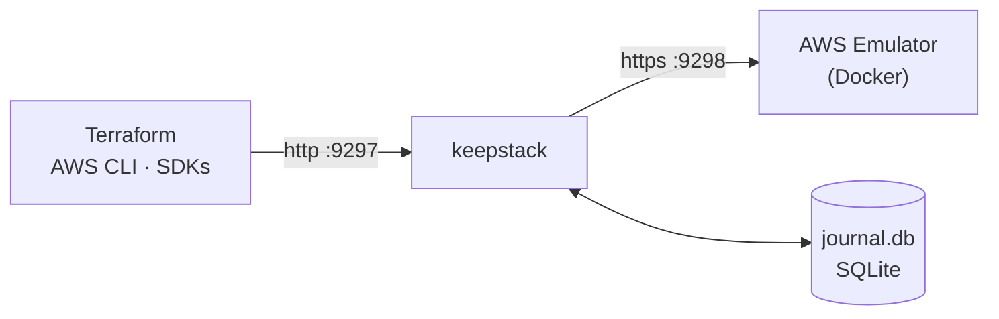

<p align="center">
  <picture>
    <source media="(prefers-color-scheme: dark)" srcset="docs/assets/keepstack-logo-white.svg">
    
  </picture>
</p>

<h3 align="center">Your local AWS survives restarts.</h3>

<p align="center">
  Persistent state for <a href="https://docs.aws.amazon.com/emulator/latest/userguide/what-is-service.html">AWS Emulator</a>.
  Reboot, come back days later, and <code>terraform plan</code> still says <em>No changes</em>.
</p>

<p align="center">
  <a href="https://github.com/sanlega/keepstack/actions/workflows/ci.yml"></a>
  <a href="LICENSE"></a>
  
  
</p>

<p align="center">
  <a href="#quick-start">Quick start</a> ·
  <a href="docs/how-it-works.md">How it works</a> ·
  <a href="docs/compatibility.md">Compatibility</a> ·
  <a href="CONTRIBUTING.md">Contributing</a>
  <br>
  <sub><strong>English</strong> · <a href="docs/i18n/README.es.md">Español</a> · <a href="docs/i18n/README.zh-CN.md">简体中文</a></sub>
</p>

<br>

## The problem

AWS Emulator is AWS's official local emulator: fast and faithful, but **everything lives in memory**.

<table>
<tr>
<th width="50%">😩 Without keepstack</th>
<th width="50%">😌 With keepstack</th>
</tr>
<tr>
<td>

```console
$ terraform apply      # 30 resources
$ # ...reboot...
$ terraform plan
Plan: 30 to add, 0 to change, 0 to destroy.
```

Everything is gone. Terraform wants to rebuild the
whole stack, and you can't see the one change you made.

</td>
<td>

```console
$ terraform apply      # 30 resources
$ # ...reboot...
$ terraform plan
No changes. Your infrastructure matches
the configuration.
```

Same VPCs, same IDs, same data. Add a subnet and
`plan` shows exactly **1 to add**.

</td>
</tr>
</table>

## Quick start

> **Requirements:** [Docker](https://docs.docker.com/get-docker/) and Python 3.10+.

**1. Install**

```sh
pipx install git+https://github.com/sanlega/keepstack
```

**2. Start it:** the emulator image is built on first run, then your saved state is restored

```sh
keepstack up -d                # in the background; or `keepstack up` to keep it in this terminal
```

**3. Point your tools at it**

```sh
eval "$(keepstack env)"        # PowerShell: keepstack env --shell powershell | iex
aws sts get-caller-identity    # "Account": "000000000000" → you're on the emulator
```

That's it. Use Terraform, the AWS CLI or any SDK as usual, and `keepstack down` whenever you like.
Try the full loop with [`examples/quickstart`](examples/quickstart/main.tf).

> [!IMPORTANT]
> Use **AWS CLI v2**: v1 ignores `AWS_ENDPOINT_URL` for some services (e.g. SQS) and would call real AWS.
> In Terraform, copy the `provider` block from the [quickstart example](examples/quickstart/main.tf).

## Everyday commands

| Command | What it does |
|---|---|
| `keepstack check` | **Before applying:** lists which resources in your Terraform project will work on the emulator, which are known to break (with workarounds) and the emulator's known gaps for each service you use. Exits 1 if something will fail, so it fits in CI. |
| `keepstack up -d` / `down` | Run in the background / stop it. The state is kept either way. |
| `keepstack status` | Is it running? How many calls are saved, per service, and how did the last restore go. |
| `keepstack logs -f` | Follow the background log. |
| `keepstack doctor` | Checks Docker, the port, your AWS CLI version and warns if real AWS credentials could leak into your session. |
| `keepstack snapshot save <name>` | Save the current state (add `--include terraform.tfstate` to save your Terraform state with it). `snapshot list`, `restore`, `delete`. |
| `keepstack export` / `import` | Share a whole environment as a single file. |
| `keepstack compact` | Shrink the journal by dropping resources that were created and later deleted. Verified in a throwaway emulator before it is applied. |
| `keepstack env` | Print the variables that point your tools at keepstack. |

```console
$ keepstack check examples/quickstart
keepstack check: examples/quickstart (scanned .tf files), emulator 1.0.322

⚠ works with a caveat
    aws_dynamodb_table          x1  PAY_PER_REQUEST shows a perpetual diff (OnDemandThroughput returns -1)
                                workaround: keepstack up --shims, or lifecycle { ignore_changes = [on_demand_throughput] }

✓ ok
    aws_kms_key                 x1  key UUID translated by keepstack
    aws_route53_zone            x1  zone ID translated by keepstack
    aws_subnet                  x2
    aws_vpc                     x1
    ...

14 resources: 13 ok, 1 with caveats, 0 broken, 0 untested.
```

Snapshots make risky changes cheap to try:

```sh
keepstack snapshot save before-upgrade --include terraform.tfstate
terraform apply                                     # ...didn't go well?
keepstack down && keepstack snapshot restore before-upgrade && keepstack up -d
```

## Features

| | |
|---|---|
| 🔁 **Survives everything** | Ctrl+C, `docker kill`, Docker restarts, reboots. If the container dies, keepstack restores it on its own. |
| 🪪 **Stable IDs** | `vpc-…`, KMS UUIDs, Secrets Manager ARNs, Route 53 zone IDs… keep their original values across restarts. |
| 🔍 **Know before you apply** | `keepstack check` tells you what will break on the emulator before you run Terraform. |
| 📸 **Snapshots** | Save, restore and share whole environments, Terraform state included. |
| 🩹 **Compatibility shims** | `--shims` works around known emulator bugs (e.g. `aws_security_group`), off by default. |
| ⚡ **Zero setup** | One command, no config. The emulator image builds itself (x86_64 and Apple silicon). |
| 🛡️ **Safe by design** | Write-ahead journal, one instance per port: a stray `--reset` can't wipe a running state. |
| 📦 **Zero dependencies** | Pure Python standard library. macOS, Linux and Windows. |
| ✅ **Tested for real** | 40+ Terraform resource types, end-to-end against a real emulator. [See the matrix →](docs/compatibility.md) |

## How it works



1. **Record:** every write is saved to the journal *before* it reaches the emulator. Reads pass straight through.
2. **Replay:** on start, a clean emulator receives the journal in order (with retries for resources still settling).
3. **Translate:** new random IDs are mapped back to the originals, so your tools never notice the restart.

State lives in `.keepstack/` next to where you run it, one state per project, like `.terraform/`.
The full design is in [docs/how-it-works.md](docs/how-it-works.md).

## Reference

<details>
<summary><strong>Commands and options</strong></summary>

<br>

```text
keepstack up        [-d] [--port 9297] [--emulator-port 9298] [--data-dir .keepstack]
                    [--image keepstack-emulator] [--reset] [--shims] [--verbose]
keepstack down      [--data-dir]
keepstack status    [--data-dir] [--json]
keepstack logs      [--data-dir] [-f]
keepstack env       [--port 9297] [--shell sh|powershell]
keepstack check     [PATH] [--plan plan.json] [--offline] [--json]
keepstack doctor    [--port] [--data-dir]
keepstack snapshot  save NAME [--include FILE ...] [--force] | list | restore NAME | delete NAME
keepstack export    FILE
keepstack import    FILE
keepstack compact   [--dry-run]
keepstack --version
```

Every command that works on a state accepts `--data-dir` (default `.keepstack`). `restore`, `import` and
`compact` need keepstack to be stopped and save the previous state as the `pre-restore` / `pre-compact` snapshot
first, so they can always be undone.

| Option | Default | Description |
|---|---|---|
| `--port` | `9297` | Port your tools connect to (plain HTTP on 127.0.0.1) |
| `--emulator-port` | `9298` | Internal port of the emulator container |
| `--data-dir` | `.keepstack` | Where the journal is stored |
| `--image` | `keepstack-emulator` | Emulator image; built automatically if it's the default and missing |
| `--reset` | | Clear the saved state and start from scratch |
| `-d`, `--detach` | | Run in the background; logs go to `.keepstack/keepstack.log` |
| `--shims` | | Work around known emulator bugs (see [how it works](docs/how-it-works.md#compatibility-shims)); remembered for that state |
| `--verbose` | | Log every request |

Run several isolated environments side by side with different `--port`, `--emulator-port` and `--data-dir`.

</details>

<details>
<summary><strong>Limitations</strong></summary>

<br>

- **Local development only:** no credential checks, emulator runs with `--auth off`, bound to `127.0.0.1`.
  See [SECURITY.md](SECURITY.md).
- **It is not AWS:** the emulator doesn't evaluate IAM and its fidelity varies by service.
  Known gaps are in the [compatibility matrix](docs/compatibility.md).
- **Heuristic ID translation:** only values that look generated are learned.
  Details in [how it works](docs/how-it-works.md#limitations).
- **The journal only grows:** compact it with `keepstack up --reset` and a fresh `terraform apply`.

</details>

## Contributing

Issues and PRs are welcome, especially new entries for the [compatibility matrix](docs/compatibility.md).
Start with [CONTRIBUTING.md](CONTRIBUTING.md).

## License

[Apache-2.0](LICENSE)

<sub>keepstack is an independent project, not affiliated with, endorsed by or sponsored by Amazon Web Services.
AWS and AWS Emulator are trademarks of Amazon.com, Inc. or its affiliates.</sub>
