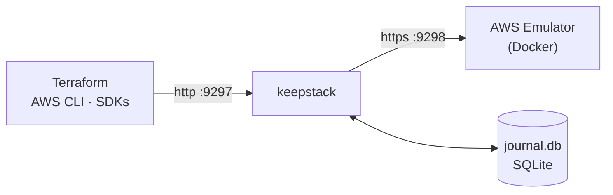

<p align="center">
  <picture>
    <source media="(prefers-color-scheme: dark)" srcset="../assets/keepstack-logo-white.svg">
    
  </picture>
</p>

<h3 align="center">Tu AWS local sobrevive a los reinicios.</h3>

<p align="center">
  Estado persistente para <a href="https://docs.aws.amazon.com/emulator/latest/userguide/what-is-service.html">AWS Emulator</a>:
  reinicia, vuelve días después y <code>terraform plan</code> sigue diciendo <em>No changes</em>.
</p>

<p align="center">
  <a href="https://github.com/sanlega/keepstack/actions/workflows/ci.yml"></a>
  <a href="../../LICENSE"></a>
  
  
</p>

<p align="center">
  <a href="#inicio-rápido">Inicio rápido</a> ·
  <a href="../how-it-works.md">Cómo funciona</a> ·
  <a href="../compatibility.md">Compatibilidad</a> ·
  <a href="../../CONTRIBUTING.md">Contribuir</a>
  <br>
  <sub><a href="../../README.md">English</a> · <strong>Español</strong> · <a href="README.zh-CN.md">简体中文</a></sub>
</p>

<p align="center"><em>Si algo difiere de esta traducción, la versión de referencia es el README en inglés.</em></p>

<br>

## El problema

AWS Emulator es el emulador local oficial de AWS: rápido y fiel, pero **todo vive en memoria**.

<table>
<tr>
<th width="50%">😩 Sin keepstack</th>
<th width="50%">😌 Con keepstack</th>
</tr>
<tr>
<td>

```console
$ terraform apply      # 30 resources
$ # ...reboot...
$ terraform plan
Plan: 30 to add, 0 to change, 0 to destroy.
```

Todo ha desaparecido. Terraform quiere reconstruir
toda la pila y no puedes ver el único cambio que hiciste.

</td>
<td>

```console
$ terraform apply      # 30 resources
$ # ...reboot...
$ terraform plan
No changes. Your infrastructure matches
the configuration.
```

Mismas VPC, mismos IDs, mismos datos. Añade una subred y
`plan` muestra exactamente **1 to add**.

</td>
</tr>
</table>

## Inicio rápido

> **Requisitos:** [Docker](https://docs.docker.com/get-docker/) y Python 3.10+.

**1. Instala**

```sh
pipx install git+https://github.com/sanlega/keepstack
```

**2. Arráncalo** — la imagen del emulador se construye la primera vez y después se restaura tu estado guardado

```sh
keepstack up
```

**3. Apunta tus herramientas a keepstack** — en otra terminal

```sh
eval "$(keepstack env)"        # PowerShell: keepstack env --shell powershell | iex
aws sts get-caller-identity    # "Account": "000000000000" → estás en el emulador
```

Eso es todo. Usa Terraform, la AWS CLI o cualquier SDK como siempre; para keepstack cuando quieras.
Prueba el ciclo completo con [`examples/quickstart`](../../examples/quickstart/main.tf).

> [!IMPORTANT]
> Usa **AWS CLI v2**: la v1 ignora `AWS_ENDPOINT_URL` en algunos servicios (p. ej. SQS) y llamaría a AWS de verdad.
> En Terraform, copia el bloque `provider` del [ejemplo quickstart](../../examples/quickstart/main.tf).

## Características

| | |
|---|---|
| 🔁 **Sobrevive a todo** | Ctrl+C, `docker kill`, reinicios de Docker, reinicios del equipo. Si el contenedor muere, keepstack lo restaura por su cuenta. |
| 🪪 **IDs estables** | `vpc-…`, UUID de KMS, ARN de Secrets Manager, IDs de zona de Route 53… conservan su valor original tras los reinicios. |
| ⚡ **Cero configuración** | Un solo comando, sin config. La imagen del emulador se construye sola (x86_64 y Apple silicon). |
| 🛡️ **Seguro por diseño** | Journal con escritura previa y una instancia por puerto: un `--reset` accidental no puede borrar un estado en ejecución. |
| 📦 **Sin dependencias** | Solo la biblioteca estándar de Python. macOS, Linux y Windows. |
| ✅ **Probado de verdad** | Más de 40 tipos de recurso de Terraform, de extremo a extremo contra un emulador real. [Ver la matriz →](../compatibility.md) |

## Cómo funciona



1. **Registro**: cada escritura se guarda en el journal *antes* de llegar al emulador. Las lecturas pasan directamente.
2. **Replay**: al arrancar, un emulador limpio recibe el journal en orden (con reintentos para los recursos que aún se están asentando).
3. **Traducción**: los nuevos IDs aleatorios se asignan de vuelta a los originales, así que tus herramientas nunca notan el reinicio.

El estado vive en `.keepstack/`, junto al directorio donde lo ejecutas: un estado por proyecto, como `.terraform/`.
El diseño completo está en [docs/how-it-works.md](../how-it-works.md).

## Referencia

<details>
<summary><strong>Comandos y opciones</strong></summary>

<br>

```text
keepstack up    [--port 9297] [--emulator-port 9298] [--data-dir .keepstack]
                [--image keepstack-emulator] [--reset] [--verbose]
keepstack env   [--port 9297] [--shell sh|powershell]
keepstack --version
```

| Opción | Por defecto | Descripción |
|---|---|---|
| `--port` | `9297` | Puerto al que se conectan tus herramientas (HTTP plano en 127.0.0.1) |
| `--emulator-port` | `9298` | Puerto interno del contenedor del emulador |
| `--data-dir` | `.keepstack` | Dónde se guarda el journal |
| `--image` | `keepstack-emulator` | Imagen del emulador; se construye automáticamente si es la de por defecto y no existe |
| `--reset` | | Borra el estado guardado y empieza de cero |
| `--verbose` | | Registra cada petición |

Puedes ejecutar varios entornos aislados en paralelo con distintos `--port`, `--emulator-port` y `--data-dir`.

</details>

<details>
<summary><strong>Limitaciones</strong></summary>

<br>

- **Solo para desarrollo local**: no hay comprobación de credenciales, el emulador se ejecuta con `--auth off` y escucha solo en `127.0.0.1`.
  Consulta [SECURITY.md](../../SECURITY.md).
- **No es AWS**: el emulador no evalúa IAM y su fidelidad varía según el servicio.
  Las carencias conocidas están en la [matriz de compatibilidad](../compatibility.md).
- **Traducción de IDs heurística**: solo se aprenden los valores que parecen generados.
  Detalles en [cómo funciona](../how-it-works.md#limitations).
- **El journal solo crece**: compáctalo con `keepstack up --reset` y un `terraform apply` nuevo.

</details>

## Contribuir

Las issues y las PR son bienvenidas, sobre todo nuevas entradas para la [matriz de compatibilidad](../compatibility.md).
Empieza por [CONTRIBUTING.md](../../CONTRIBUTING.md).

## Licencia

[Apache-2.0](../../LICENSE)

<sub>keepstack es un proyecto independiente, sin afiliación, respaldo ni patrocinio de Amazon Web Services.
AWS y AWS Emulator son marcas comerciales de Amazon.com, Inc. o sus filiales.</sub>
