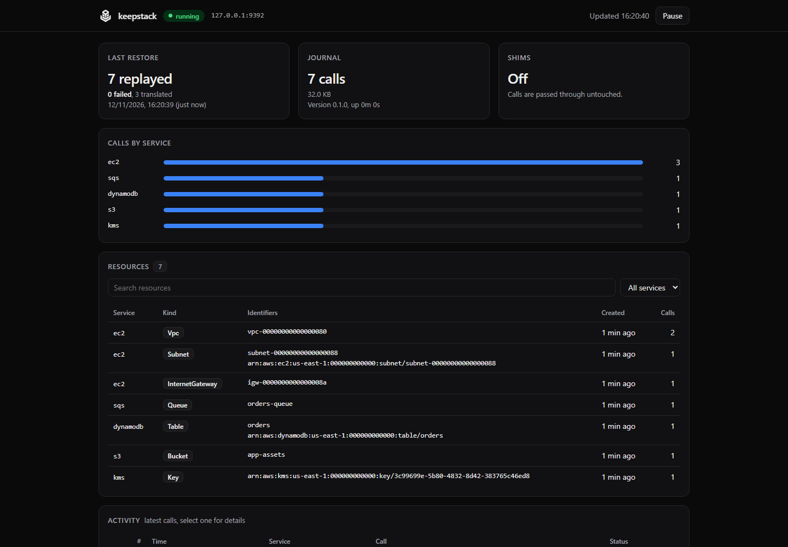
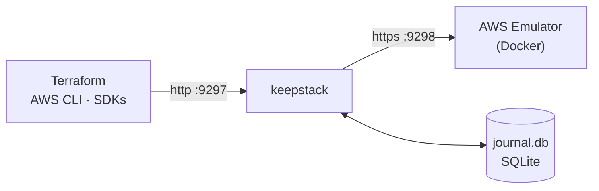

<p align="center">
  <picture>
    <source media="(prefers-color-scheme: dark)" srcset="../assets/keepstack-logo-white.svg">
    
  </picture>
</p>

<h3 align="center">Prueba tu Terraform en un AWS local antes de tocar el real.</h3>

<p align="center">
  keepstack le da memoria al <a href="https://docs.aws.amazon.com/emulator/latest/userguide/what-is-service.html">AWS Emulator</a> oficial.
  Tu infraestructura local sobrevive a los reinicios con los mismos IDs, y cada pull request se aplica sobre lo que
  <code>main</code> ya construyó. Sin cuenta de AWS ni tokens.
</p>

<p align="center">
  <a href="https://github.com/sanlega/keepstack/actions/workflows/ci.yml"></a>
  <a href="../../LICENSE"></a>
  
  
</p>

<p align="center">
  <a href="#inicio-rápido">Inicio rápido</a> ·
  <a href="#valida-pull-requests">Valida pull requests</a> ·
  <a href="../how-it-works.md">Cómo funciona</a> ·
  <a href="../compatibility.md">Compatibilidad</a> ·
  <a href="../../CONTRIBUTING.md">Contribuir</a>
  <br>
  <sub><a href="../../README.md">English</a> · <strong>Español</strong> · <a href="README.zh-CN.md">简体中文</a></sub>
</p>

<p align="center"><em>Si algo difiere de esta traducción, la versión de referencia es el README en inglés.</em></p>

<br>

## Dos formas de usarlo

<table>
<tr>
<th width="50%">💻 En tu máquina</th>
<th width="50%">🔁 En cada pull request</th>
</tr>
<tr>
<td>

El AWS Emulator oficial, con memoria. Aplica, reinicia, vuelve días después: `terraform plan` sigue diciendo
*No changes*, con los mismos IDs de VPC, ARN y datos. Añade un recurso y el plan muestra exactamente ese.

**→ [Inicio rápido](#inicio-rápido)**

</td>
<td>

Un paso en GitHub Actions aplica el pull request sobre el entorno que `main` ya construyó y comenta en el PR el plan
incremental y cada problema: errores de configuración, carencias del emulador, recursos no idempotentes.

**→ [Valida pull requests](#valida-pull-requests)**

</td>
</tr>
</table>

## El problema

AWS Emulator es el emulador local oficial de AWS: rápido y fiel, pero **todo vive en memoria**.

<table>
<tr>
<th width="50%">😩 Sin keepstack</th>
<th width="50%">😌 Con keepstack</th>
</tr>
<tr>
<td>

```console
$ terraform apply      # 30 resources
$ # ...reboot...
$ terraform plan
Plan: 30 to add, 0 to change, 0 to destroy.
```

Todo ha desaparecido. Terraform quiere reconstruir
toda la pila y no puedes ver el único cambio que hiciste.

</td>
<td>

```console
$ terraform apply      # 30 resources
$ # ...reboot...
$ terraform plan
No changes. Your infrastructure matches
the configuration.
```

Mismas VPC, mismos IDs, mismos datos. Añade una subred y
`plan` muestra exactamente **1 to add**.

</td>
</tr>
</table>

## Inicio rápido

> **Requisitos:** [Docker](https://docs.docker.com/get-docker/) y Python 3.10+.

**1. Instala**

```sh
pipx install keepstack         # o: uv tool install keepstack
```

**2. Arráncalo:** la imagen del emulador se construye la primera vez y después se restaura tu estado guardado

```sh
keepstack up -d                # en segundo plano; o `keepstack up` para mantenerlo en esta terminal
```

**3. Apunta tus herramientas a keepstack**

```sh
eval "$(keepstack env)"        # PowerShell: keepstack env --shell powershell | iex
aws sts get-caller-identity    # "Account": "000000000000" → estás en el emulador
```

Eso es todo. Usa Terraform, la AWS CLI o cualquier SDK como siempre, y `keepstack down` cuando quieras.
Prueba el ciclo completo con [`examples/quickstart`](../../examples/quickstart/main.tf).

> [!IMPORTANT]
> Usa **AWS CLI v2**: la v1 ignora `AWS_ENDPOINT_URL` en algunos servicios (p. ej. SQS) y llamaría a AWS de verdad.
> En Terraform, copia el bloque `provider` del [ejemplo quickstart](../../examples/quickstart/main.tf).

## Valida pull requests


Con un solo paso, cada pull request que toque tu infraestructura se aplica en el emulador oficial de AWS, sin cuenta de
AWS ni tokens:

```yaml
# .github/workflows/infra.yml
on:
  push:
    branches: [main]
  pull_request:

jobs:
  validate:
    runs-on: ubuntu-latest
    permissions:
      contents: read
      pull-requests: write   # para el comentario en el PR
    steps:
      - uses: actions/checkout@v7
      - uses: sanlega/keepstack@v0.3.0
        with:
          validate: infra/            # tu directorio Terraform
          baseline: true              # valida los PR sobre el entorno de main
          shims: true
          run: pytest tests/smoke     # opcional: comprueba que los recursos funcionan
```

- **Resumen del job y un comentario fijo en el PR** con el plan, los pasos y cada problema encontrado.
- **Anotaciones en línea** sobre las líneas `.tf` que fallan.
- **Baseline:** los push a `main` guardan el entorno resultante; los pull requests lo restauran y se aplican encima, así
  que el informe muestra el plan incremental real (reemplazos, borrados, bloques `moved`) en vez de un apply desde cero.
  Los demás emuladores locales empiezan con una cuenta vacía en cada ejecución.

El comentario que deja en el pull request (este detectó un reemplazo y un recurso no idempotente):


> ### keepstack validate: `infra` ❌ failed
>
> | Step | Result |
> |---|---|
> | init | ✅ ok |
> | plan | ✅ ok |
> | apply | ✅ ok |
> | idempotency | ❌ failed |
> | smoke | ✅ ok |
>
> **Plan:** 1 to add, 1 to change, 1 to replace, 0 to destroy
>
> > [!WARNING]
> > Destructive changes:
> > - `aws_sqs_queue.jobs` will be **replaced**
>
> | | Kind | Resource | Message |
> |---|---|---|---|
> | 🔁 | not idempotent | `aws_dynamodb_table.items` `main.tf:58` | plan is not empty after apply (update)<br>*Hint:* keepstack up --shims, or lifecycle { ignore_changes = [on_demand_throughput] } |
>
> <details><summary>Planned changes</summary>
>
> - `create` aws_subnet.b
> - `replace` aws_sqs_queue.jobs
> - `update` aws_dynamodb_table.items
>
> </details>
>
> <sub>keepstack · 52.3 s · AWS Emulator, no AWS account used</sub>

## Comandos del día a día

| Comando | Qué hace |
|---|---|
| `keepstack check` | **Antes de aplicar:** lista qué recursos de tu proyecto Terraform funcionarán en el emulador, cuáles se sabe que fallan (con soluciones alternativas) y las carencias conocidas del emulador y su puntuación oficial de fidelidad en cada servicio que usas. Termina con código 1 si algo va a fallar, así que encaja en CI. |
| `keepstack validate` | **Aplica de verdad, en local:** ejecuta `init`, `plan`, `apply` y un segundo `plan` contra keepstack, y separa errores de configuración, carencias del emulador y recursos no idempotentes. No toca tus ficheros ni tu backend. Termina con código 1 si falla. |
| `keepstack up -d` / `down` | Ejecuta en segundo plano / lo detiene. El estado se conserva en ambos casos. |
| `keepstack status` | ¿Está en marcha? Cuántas llamadas hay guardadas, por servicio, y cómo fue la última restauración. |
| `keepstack ui` | Abre el panel web: recursos, llamadas recientes, traducciones de IDs y snapshots. |
| `keepstack logs -f` | Sigue el registro en segundo plano. |
| `keepstack doctor` | Comprueba Docker, el puerto, la versión de tu AWS CLI y avisa si unas credenciales reales de AWS podrían filtrarse a tu sesión. |
| `keepstack snapshot save <name>` | Guarda el estado actual (añade `--include terraform.tfstate` para guardar contigo tu estado de Terraform). También `snapshot list`, `restore`, `delete`. |
| `keepstack export` / `import` | Comparte un entorno completo como un único archivo. |
| `keepstack compact` | Reduce el journal eliminando los recursos que se crearon y luego se borraron. Se verifica en un emulador desechable antes de aplicarlo. |
| `keepstack env` | Imprime las variables que apuntan tus herramientas a keepstack. |

```console
$ keepstack check examples/quickstart
keepstack check: examples/quickstart (scanned .tf files), emulator 1.0.322

⚠ works with a caveat
    aws_dynamodb_table          x1  PAY_PER_REQUEST shows a perpetual diff (OnDemandThroughput returns -1)
                                workaround: keepstack up --shims, or lifecycle { ignore_changes = [on_demand_throughput] }

✓ ok
    aws_kms_key                 x1  key UUID translated by keepstack
    aws_route53_zone            x1  zone ID translated by keepstack
    aws_subnet                  x2
    aws_vpc                     x1
    ...

Emulator fidelity for the services you use (official AWS tests, emulator 1.0.338, latest release):
    ec2              44%  (770/1731 tests)
    dynamodb         71%  (1053/1481 tests)
    sqs              89%  (299/335 tests)
    ...

14 resources: 13 ok, 1 with caveats, 0 broken, 0 untested.
```

`keepstack check` también es un hook de [pre-commit](https://pre-commit.com). Funciona sin conexión y sin Docker:

```yaml
# .pre-commit-config.yaml
repos:
  - repo: https://github.com/sanlega/keepstack
    rev: v0.3.0
    hooks:
      - id: keepstack-check
        args: [infra]   # tu directorio Terraform (por defecto: la raíz del repositorio)
```

Los snapshots hacen barato probar cambios arriesgados:

```sh
keepstack snapshot save before-upgrade --include terraform.tfstate
terraform apply                                     # ...¿no ha ido bien?
keepstack down && keepstack snapshot restore before-upgrade && keepstack up -d
```

## Validar un proyecto Terraform

`keepstack validate` responde a "¿funcionaría este apply y queda limpio?" sin cuenta de AWS. Arranca keepstack si hace
falta, apunta Terraform a él con un fichero override temporal (tu backend y tu `.terraform` no se tocan), aplica, vuelve
a planificar y clasifica cada problema:

| | Tipo | ¿Hace fallar? |
|---|---|---|
| ❌ | **Error de configuración**: AWS o el provider rechazaron la petición | Sí |
| 🔁 | **No idempotente**: el plan no sale vacío justo después del apply | Sí |
| ⚠️ | **Carencia del emulador**: el emulador no implementa esa API o servicio (HTTP 501, `UnknownService`) o tiene un bug conocido | Solo con `--strict` |

```console
$ keepstack validate infra/
keepstack validate: infra/  ->  PASSED (41.2 s)

steps: init ok, plan ok, apply gap, idempotency skipped
changes: 6 to add, 0 to change, 0 to replace, 0 to destroy

emulator gap: aws_athena_workgroup.reports (main.tf:42)
    ... StatusCode: 501, api error NotImplemented: operation ListTagsForResource ...
    hint: the emulator does not implement this API yet
```

El estado de Terraform vive en el directorio de datos de keepstack, así que la siguiente ejecución parte de la
infraestructura que dejó la anterior: el plan muestra solo lo que cambia, como un despliegue real. Los reemplazos y
borrados se listan, y `--fail-on-destroy` los convierte en fallo.

Añade `--run "pytest tests/smoke"` (repetible) para comprobar que los recursos funcionan de verdad tras el apply: el
comando recibe las variables de AWS y cada output de Terraform como `TF_OUTPUT_<nombre>`, y si termina con error la
validación falla. En GitHub Actions cada hallazgo se muestra además como anotación en la línea del `.tf`, dentro del diff
del pull request. Otras opciones: `--json`, `--report FICHERO`,
`--markdown FICHERO` (p. ej. `$GITHUB_STEP_SUMMARY`), `--destroy`, `--shims`, `--terraform tofu`.

## Panel

`keepstack ui` abre un panel de solo lectura servido por el propio keepstack, en el mismo puerto. Muestra qué existe en tu
AWS local según el journal, las últimas llamadas (haz clic en una para ver la petición y la respuesta), las traducciones
de IDs y tus snapshots. Solo responde en `127.0.0.1`.

<p align="center"></p>

## En GitHub Actions

### Solo un AWS local

La validación de pull requests está descrita [más arriba](#valida-pull-requests).

Sin `validate`, la acción solo arranca keepstack y apunta a él la AWS CLI, los SDK y Terraform:

```yaml
      - uses: sanlega/keepstack@v0.3.0
        with:
          cache: true          # opcional: conserva el estado entre ejecuciones
      - run: terraform init && terraform apply -auto-approve
```

| Entrada | Por defecto | Descripción |
|---|---|---|
| `validate` | | Directorio Terraform a validar. Vacío: solo arranca keepstack |
| `baseline` | `false` | Guarda el entorno en los push a la rama principal y valida los pull requests encima |
| `comment` | `true` | Publica el informe como un único comentario en el pull request, actualizado en cada ejecución |
| `run` | | Comandos tras el apply, uno por línea (ver `validate --run`) |
| `strict` | `false` | Las carencias del emulador también hacen fallar |
| `fail-on-destroy` | `false` | Falla si el plan reemplaza o destruye recursos |
| `shims` | `false` | Igual que `keepstack up --shims` |
| `cache` | `false` | Sin `validate`: restaura el estado de la ejecución anterior y lo guarda al final del job |
| `cache-key` | `keepstack` | Prefijo de la clave de caché, para entornos independientes |
| `port` | `9297` | Puerto en el que escucha keepstack |
| `data-dir` | `.keepstack` | Directorio de estado |
| `python-version` | `3.12` | Python con el que se ejecuta keepstack |
| `github-token` | `github.token` | Token para el comentario del pull request |

Salidas: `endpoint-url`, `result` (`passed` / `failed`), `report` (ruta del informe JSON), `baseline-restored`. La
acción necesita un runner Linux (Docker con contenedores Linux) e instala Terraform si el runner no lo tiene.

## Características

| | |
|---|---|
| 🧪 **Valida pull requests** | `keepstack validate` aplica tu Terraform en local y distingue errores de configuración, carencias del emulador y recursos no idempotentes, con fichero y línea. |
| 🧱 **Incremental, como en producción** | Los pull requests se aplican sobre el entorno de `main`, así que los reemplazos y borrados aparecen antes de llegar a AWS. |
| 🔁 **Sobrevive a todo** | Ctrl+C, `docker kill`, reinicios de Docker, reinicios del equipo, incluso un crash en mitad de un `terraform apply`. Lo comprueba cada noche una [suite de caos](../how-it-works.md#crash-safety). |
| 🪪 **IDs estables** | `vpc-…`, UUID de KMS, ARN de Secrets Manager, IDs de zona de Route 53… conservan su valor original tras los reinicios. |
| 🔍 **Sabes antes de aplicar** | `keepstack check` te dice qué fallará en el emulador antes de ejecutar Terraform. |
| 📸 **Snapshots** | Guarda, restaura y comparte entornos completos, estado de Terraform incluido. |
| 🩹 **Shims de compatibilidad** | `--shims` esquiva errores conocidos del emulador (p. ej. `aws_security_group`), desactivado por defecto. |
| ⚡ **Cero configuración** | Un solo comando, sin config. La imagen del emulador se construye sola (x86_64 y Apple silicon). |
| 🛡️ **Seguro por diseño** | Journal con escritura previa y una instancia por puerto: un `--reset` accidental no puede borrar un estado en ejecución. |
| 📦 **Sin dependencias** | Solo la biblioteca estándar de Python. macOS, Linux y Windows. |
| ✅ **Probado de verdad** | Más de 40 tipos de recurso de Terraform, de extremo a extremo contra un emulador real. [Ver la matriz →](../compatibility.md) |

## Cómo funciona



1. **Registro**: cada escritura se guarda en el journal *antes* de llegar al emulador. Las lecturas pasan directamente.
2. **Replay**: al arrancar, un emulador limpio recibe el journal en orden (con reintentos para los recursos que aún se están asentando).
3. **Traducción**: los nuevos IDs aleatorios se asignan de vuelta a los originales, así que tus herramientas nunca notan el reinicio.

El estado vive en `.keepstack/`, junto al directorio donde lo ejecutas: un estado por proyecto, como `.terraform/`.
El diseño completo está en [docs/how-it-works.md](../how-it-works.md).

## Referencia

<details>
<summary><strong>Comandos y opciones</strong></summary>

<br>

```text
keepstack up        [-d] [--port 9297] [--emulator-port 9298] [--data-dir .keepstack]
                    [--image keepstack-emulator] [--reset] [--shims] [--verbose]
keepstack down      [--data-dir]
keepstack status    [--data-dir] [--json]
keepstack logs      [--data-dir] [-f]
keepstack env       [--port 9297] [--shell sh|powershell|dotenv]
keepstack ui        [--port 9297] [--no-browser]
keepstack check     [PATH] [--plan plan.json] [--offline] [--json]
keepstack doctor    [--port] [--data-dir]
keepstack snapshot  save NAME [--include FILE ...] [--force] | list | restore NAME | delete NAME
keepstack export    FILE
keepstack import    FILE
keepstack compact   [--dry-run]
keepstack --version
```

Todos los comandos que trabajan sobre un estado aceptan `--data-dir` (por defecto `.keepstack`). `restore`, `import` y
`compact` necesitan que keepstack esté parado y guardan antes el estado anterior como snapshot `pre-restore` / `pre-compact`,
para poder deshacerlos siempre.

| Opción | Por defecto | Descripción |
|---|---|---|
| `--port` | `9297` | Puerto al que se conectan tus herramientas (HTTP plano en 127.0.0.1) |
| `--emulator-port` | `9298` | Puerto interno del contenedor del emulador |
| `--data-dir` | `.keepstack` | Dónde se guarda el journal |
| `--image` | `keepstack-emulator` | Imagen del emulador; se construye automáticamente si es la de por defecto y no existe |
| `--reset` | | Borra el estado guardado y empieza de cero |
| `-d`, `--detach` | | Ejecuta en segundo plano; los registros van a `.keepstack/keepstack.log` |
| `--shims` | | Esquiva errores conocidos del emulador (consulta [cómo funciona](../how-it-works.md#compatibility-shims)); se recuerda para ese estado |
| `--verbose` | | Registra cada petición |

Puedes ejecutar varios entornos aislados en paralelo con distintos `--port`, `--emulator-port` y `--data-dir`.

</details>

<details>
<summary><strong>Limitaciones</strong></summary>

<br>

- **Solo para desarrollo local**: no hay comprobación de credenciales, el emulador se ejecuta con `--auth off` y escucha solo en `127.0.0.1`.
  Consulta [SECURITY.md](../../SECURITY.md).
- **No es AWS**: el emulador no evalúa IAM y su fidelidad varía según el servicio.
  Las carencias conocidas están en la [matriz de compatibilidad](../compatibility.md).
- **Traducción de IDs heurística**: solo se aprenden los valores que parecen generados.
  Detalles en [cómo funciona](../how-it-works.md#limitations).
- **El journal solo crece** hasta que ejecutas `keepstack compact`, que elimina los recursos creados y luego
  borrados.
- **CloudFormation / CDK:** los stacks persisten, pero los nombres físicos que genera CloudFormation (recursos sin
  `QueueName`, `BucketName`...) cambian tras un reinicio. Pon nombre a los recursos de los que dependas.

</details>

## Contribuir

Las issues y las PR son bienvenidas, sobre todo nuevas entradas para la [matriz de compatibilidad](../compatibility.md).
Empieza por [CONTRIBUTING.md](../../CONTRIBUTING.md).

## Licencia

[Apache-2.0](../../LICENSE)

<sub>keepstack es un proyecto independiente, sin afiliación, respaldo ni patrocinio de Amazon Web Services.
AWS y AWS Emulator son marcas comerciales de Amazon.com, Inc. o sus filiales.</sub>
