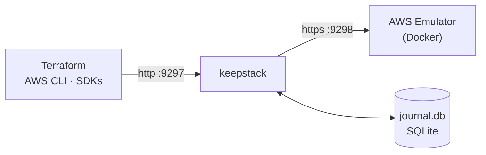

<p align="center">
  <picture>
    <source media="(prefers-color-scheme: dark)" srcset="../assets/keepstack-logo-white.svg">
    
  </picture>
</p>

<h3 align="center">你的本地 AWS，重启后依然保留。</h3>

<p align="center">
  为 <a href="https://docs.aws.amazon.com/emulator/latest/userguide/what-is-service.html">AWS Emulator</a> 提供持久化状态——
  重启电脑，几天后再回来，<code>terraform plan</code> 仍然显示 <em>No changes</em>。
</p>

<p align="center">
  <a href="https://github.com/sanlega/keepstack/actions/workflows/ci.yml"></a>
  <a href="../../LICENSE"></a>
  
  
</p>

<p align="center">
  <a href="#快速开始">快速开始</a> ·
  <a href="../how-it-works.md">工作原理</a> ·
  <a href="../compatibility.md">兼容性</a> ·
  <a href="../../CONTRIBUTING.md">参与贡献</a>
  <br>
  <sub><a href="../../README.md">English</a> · <a href="README.es.md">Español</a> · <strong>简体中文</strong></sub>
</p>

<p align="center"><em>如与本译文存在出入，以英文 README 为准。</em></p>

<br>

## 问题所在

AWS Emulator 是 AWS 官方提供的本地模拟器——速度快、还原度高，但**所有数据都只保存在内存中**。

<table>
<tr>
<th width="50%">😩 没有 keepstack</th>
<th width="50%">😌 使用 keepstack</th>
</tr>
<tr>
<td>

```console
$ terraform apply      # 30 resources
$ # ...reboot...
$ terraform plan
Plan: 30 to add, 0 to change, 0 to destroy.
```

一切都没了。Terraform 想把整套环境重新创建一遍，
你根本看不到自己做的那一处改动。

</td>
<td>

```console
$ terraform apply      # 30 resources
$ # ...reboot...
$ terraform plan
No changes. Your infrastructure matches
the configuration.
```

VPC、ID、数据都和之前一样。新增一个子网后，
`plan` 只会显示 **1 to add**。

</td>
</tr>
</table>

## 快速开始

> **环境要求：** [Docker](https://docs.docker.com/get-docker/) 和 Python 3.10+。

**1. 安装**

```sh
pipx install git+https://github.com/sanlega/keepstack
```

**2. 启动** — 首次运行会自动构建模拟器镜像，然后恢复你之前保存的状态

```sh
keepstack up
```

**3. 让你的工具指向 keepstack** — 在另一个终端中

```sh
eval "$(keepstack env)"        # PowerShell: keepstack env --shell powershell | iex
aws sts get-caller-identity    # "Account": "000000000000" → 说明你连上的是模拟器
```

就这么简单。像往常一样使用 Terraform、AWS CLI 或任意 SDK；想停就随时停掉 keepstack。
用 [`examples/quickstart`](../../examples/quickstart/main.tf) 完整体验一遍。

> [!IMPORTANT]
> 请使用 **AWS CLI v2**：v1 对部分服务（例如 SQS）会忽略 `AWS_ENDPOINT_URL`，请求会被发往真实的 AWS。
> 在 Terraform 中，请复制[快速开始示例](../../examples/quickstart/main.tf)里的 `provider` 配置块。

## 特性

| | |
|---|---|
| 🔁 **任何情况都不丢状态** | Ctrl+C、`docker kill`、Docker 重启、整机重启均可。容器挂掉时，keepstack 会自动将其恢复。 |
| 🪪 **ID 保持稳定** | `vpc-…`、KMS UUID、Secrets Manager ARN、Route 53 托管区域 ID 等，重启前后保持原值。 |
| ⚡ **零配置** | 一条命令，无需配置。模拟器镜像会自动构建（x86_64 和 Apple silicon）。 |
| 🛡️ **设计上就很安全** | 预写式 journal，每个端口只允许一个实例——误敲的 `--reset` 也无法清掉正在运行的状态。 |
| 📦 **无依赖** | 仅使用 Python 标准库，支持 macOS、Linux 和 Windows。 |
| ✅ **真实测试** | 40 多种 Terraform 资源类型，针对真实模拟器做端到端测试。[查看矩阵 →](../compatibility.md) |

## 工作原理



1. **记录**——每个写操作都会在到达模拟器*之前*先写入 journal；读请求直接透传。
2. **重放**——启动时，一个干净的模拟器会按顺序接收 journal 中的操作（对仍在就绪过程中的资源会自动重试）。
3. **转换**——新生成的随机 ID 会被映射回原始值，因此你的工具完全察觉不到重启。

状态保存在你运行命令所在目录的 `.keepstack/` 中——每个项目一份状态，和 `.terraform/` 类似。
完整设计请阅读 [docs/how-it-works.md](../how-it-works.md)。

## 参考

<details>
<summary><strong>命令与选项</strong></summary>

<br>

```text
keepstack up    [--port 9297] [--emulator-port 9298] [--data-dir .keepstack]
                [--image keepstack-emulator] [--reset] [--verbose]
keepstack env   [--port 9297] [--shell sh|powershell]
keepstack --version
```

| 选项 | 默认值 | 说明 |
|---|---|---|
| `--port` | `9297` | 你的工具连接的端口（127.0.0.1 上的明文 HTTP） |
| `--emulator-port` | `9298` | 模拟器容器的内部端口 |
| `--data-dir` | `.keepstack` | journal 的存放位置 |
| `--image` | `keepstack-emulator` | 模拟器镜像；如果使用默认值且本地不存在，会自动构建 |
| `--reset` | | 清除已保存的状态，从头开始 |
| `--verbose` | | 记录每一个请求 |

只要为每个环境指定不同的 `--port`、`--emulator-port` 和 `--data-dir`，就可以同时运行多个相互隔离的环境。

</details>

<details>
<summary><strong>局限性</strong></summary>

<br>

- **仅限本地开发**——不校验凭证，模拟器以 `--auth off` 运行，且只绑定 `127.0.0.1`。
  参见 [SECURITY.md](../../SECURITY.md)。
- **它不是 AWS**——模拟器不会评估 IAM，各服务的还原度也参差不齐。
  已知的缺陷列在[兼容性矩阵](../compatibility.md)中。
- **ID 转换基于启发式规则**——只有看起来像生成标识符的值才会被学习。
  详情参见[工作原理](../how-it-works.md#limitations)。
- **journal 只增不减**——如需压缩，请执行 `keepstack up --reset`，然后重新运行 `terraform apply`。

</details>

## 参与贡献

欢迎提交 issue 和 PR，尤其欢迎为[兼容性矩阵](../compatibility.md)补充新条目。
请先阅读 [CONTRIBUTING.md](../../CONTRIBUTING.md)。

## 许可证

[Apache-2.0](../../LICENSE)

<sub>keepstack 是一个独立项目，与 Amazon Web Services 没有隶属关系，也未获得其认可或赞助。
AWS 和 AWS Emulator 是 Amazon.com, Inc. 或其关联公司的商标。</sub>
