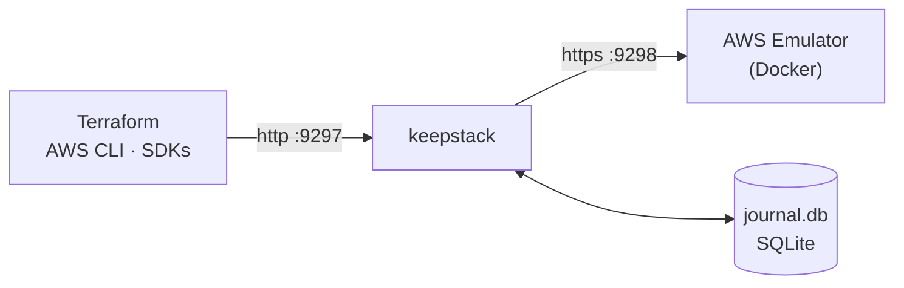

<p align="center">
  <picture>
    <source media="(prefers-color-scheme: dark)" srcset="../assets/keepstack-logo-white.svg">
    
  </picture>
</p>

<h3 align="center">在 Terraform 触及真实 AWS 之前，先在本地 AWS 上测试。</h3>

<p align="center">
  keepstack 让官方 <a href="https://docs.aws.amazon.com/emulator/latest/userguide/what-is-service.html">AWS Emulator</a> 拥有记忆。
  本地基础设施在重启后保留，ID 不变；每个拉取请求都在 <code>main</code> 已构建的环境之上执行 apply。
  无需 AWS 账号，无需令牌。
</p>

<p align="center">
  <a href="https://github.com/sanlega/keepstack/actions/workflows/ci.yml"></a>
  <a href="../../LICENSE"></a>
  
  
</p>

<p align="center">
  <a href="#快速开始">快速开始</a> ·
  <a href="#验证拉取请求">验证拉取请求</a> ·
  <a href="../how-it-works.md">工作原理</a> ·
  <a href="../compatibility.md">兼容性</a> ·
  <a href="../../CONTRIBUTING.md">参与贡献</a>
  <br>
  <sub><a href="../../README.md">English</a> · <a href="README.es.md">Español</a> · <strong>简体中文</strong></sub>
</p>

<p align="center"><em>如与本译文存在出入，以英文 README 为准。</em></p>

<br>

## 两种用法

<table>
<tr>
<th width="50%">💻 在你的电脑上</th>
<th width="50%">🔁 在每个拉取请求中</th>
</tr>
<tr>
<td>

拥有记忆的官方 AWS Emulator。执行 apply、重启电脑、几天后再回来：`terraform plan` 仍然显示 *No changes*，VPC ID、ARN
和数据都不变。新增一个资源，plan 就只显示这一个。

**→ [快速开始](#快速开始)**

</td>
<td>

GitHub Actions 中的一个步骤会在 `main` 已构建的环境之上 apply 拉取请求，并在 PR 中评论增量 plan 和每个问题：配置错误、
模拟器缺陷、非幂等资源。

**→ [验证拉取请求](#验证拉取请求)**

</td>
</tr>
</table>

## 问题所在

AWS Emulator 是 AWS 官方提供的本地模拟器，速度快、还原度高，但**所有数据都只保存在内存中**。

<table>
<tr>
<th width="50%">😩 没有 keepstack</th>
<th width="50%">😌 使用 keepstack</th>
</tr>
<tr>
<td>

```console
$ terraform apply      # 30 resources
$ # ...reboot...
$ terraform plan
Plan: 30 to add, 0 to change, 0 to destroy.
```

一切都没了。Terraform 想把整套环境重新创建一遍，
你根本看不到自己做的那一处改动。

</td>
<td>

```console
$ terraform apply      # 30 resources
$ # ...reboot...
$ terraform plan
No changes. Your infrastructure matches
the configuration.
```

VPC、ID、数据都和之前一样。新增一个子网后，
`plan` 只会显示 **1 to add**。

</td>
</tr>
</table>

## 快速开始

> **环境要求：** [Docker](https://docs.docker.com/get-docker/) 和 Python 3.10+。

**1. 安装**

```sh
pipx install keepstack         # 或：uv tool install keepstack
```

**2. 启动**：首次运行会自动构建模拟器镜像，然后恢复你之前保存的状态

```sh
keepstack up -d                # 在后台运行；或用 `keepstack up` 让它占用当前终端
```

**3. 让你的工具指向 keepstack**

```sh
eval "$(keepstack env)"        # PowerShell: keepstack env --shell powershell | iex
aws sts get-caller-identity    # "Account": "000000000000" → 说明你连上的是模拟器
```

就这么简单。像往常一样使用 Terraform、AWS CLI 或任意 SDK，想停就随时执行 `keepstack down`。
用 [`examples/quickstart`](../../examples/quickstart/main.tf) 完整体验一遍。

> [!IMPORTANT]
> 请使用 **AWS CLI v2**：v1 对部分服务（例如 SQS）会忽略 `AWS_ENDPOINT_URL`，请求会被发往真实的 AWS。
> 在 Terraform 中，请复制[快速开始示例](../../examples/quickstart/main.tf)里的 `provider` 配置块。

## 验证拉取请求


只需一个步骤，每个涉及基础设施的拉取请求都会在官方 AWS Emulator 上执行 apply，无需 AWS 账号或令牌：

```yaml
# .github/workflows/infra.yml
on:
  push:
    branches: [main]
  pull_request:

jobs:
  validate:
    runs-on: ubuntu-latest
    permissions:
      contents: read
      pull-requests: write   # 用于 PR 评论
    steps:
      - uses: actions/checkout@v7
      - uses: sanlega/keepstack@v0.3.0
        with:
          validate: infra/            # 你的 Terraform 目录
          baseline: true              # 在 main 的环境之上验证 PR
          shims: true
          run: pytest tests/smoke     # 可选：检查资源是否真的可用
```

- **作业摘要和一条固定的 PR 评论**，包含 plan、各个步骤以及发现的每个问题。
- 在出错的 `.tf` 行上显示**行内注释**。
- **基线：** 推送到 `main` 时保存得到的环境；拉取请求会恢复它并在其之上执行 apply，因此报告显示的是真实的增量 plan
  （替换、销毁、`moved` 块），而不是从零开始的 apply。其他本地模拟器每次运行都从空账号开始。

它在拉取请求中留下的评论（这次发现了一次替换和一个非幂等资源）：


> ### keepstack validate: `infra` ❌ failed
>
> | Step | Result |
> |---|---|
> | init | ✅ ok |
> | plan | ✅ ok |
> | apply | ✅ ok |
> | idempotency | ❌ failed |
> | smoke | ✅ ok |
>
> **Plan:** 1 to add, 1 to change, 1 to replace, 0 to destroy
>
> > [!WARNING]
> > Destructive changes:
> > - `aws_sqs_queue.jobs` will be **replaced**
>
> | | Kind | Resource | Message |
> |---|---|---|---|
> | 🔁 | not idempotent | `aws_dynamodb_table.items` `main.tf:58` | plan is not empty after apply (update)<br>*Hint:* keepstack up --shims, or lifecycle { ignore_changes = [on_demand_throughput] } |
>
> <details><summary>Planned changes</summary>
>
> - `create` aws_subnet.b
> - `replace` aws_sqs_queue.jobs
> - `update` aws_dynamodb_table.items
>
> </details>
>
> <sub>keepstack · 52.3 s · AWS Emulator, no AWS account used</sub>

## 常用命令

| 命令 | 作用 |
|---|---|
| `keepstack check` | **应用之前：** 列出你的 Terraform 项目中哪些资源能在模拟器上正常工作、哪些已知会出问题（附变通方法），以及你所用每个服务在模拟器上的已知缺陷和官方保真度得分。若有会失败的项则以退出码 1 结束，因此适合放进 CI。 |
| `keepstack validate` | **在本地真正执行 apply：** 针对 keepstack 运行 `init`、`plan`、`apply` 和第二次 `plan`，并区分配置错误、模拟器缺陷和非幂等资源。不会改动你的文件或后端。失败时以退出码 1 结束。 |
| `keepstack up -d` / `down` | 在后台运行 / 停止。两种方式下状态都会保留。 |
| `keepstack status` | 是否在运行？按服务统计已保存多少次调用，以及上次恢复的情况如何。 |
| `keepstack ui` | 打开 Web 仪表盘：资源、最近的调用、ID 转换和快照。 |
| `keepstack logs -f` | 持续查看后台日志。 |
| `keepstack doctor` | 检查 Docker、端口、AWS CLI 版本，并在真实 AWS 凭证可能泄漏到当前会话时发出警告。 |
| `keepstack snapshot save <name>` | 保存当前状态（加上 `--include terraform.tfstate` 可一并保存你的 Terraform 状态）。另有 `snapshot list`、`restore`、`delete`。 |
| `keepstack export` / `import` | 将整个环境作为单个文件分享。 |
| `keepstack compact` | 丢弃已创建后又被删除的资源，缩小 journal。应用前会先在一次性模拟器中验证。 |
| `keepstack env` | 输出让你的工具指向 keepstack 的环境变量。 |

```console
$ keepstack check examples/quickstart
keepstack check: examples/quickstart (scanned .tf files), emulator 1.0.322

⚠ works with a caveat
    aws_dynamodb_table          x1  PAY_PER_REQUEST shows a perpetual diff (OnDemandThroughput returns -1)
                                workaround: keepstack up --shims, or lifecycle { ignore_changes = [on_demand_throughput] }

✓ ok
    aws_kms_key                 x1  key UUID translated by keepstack
    aws_route53_zone            x1  zone ID translated by keepstack
    aws_subnet                  x2
    aws_vpc                     x1
    ...

Emulator fidelity for the services you use (official AWS tests, emulator 1.0.338, latest release):
    ec2              44%  (770/1731 tests)
    dynamodb         71%  (1053/1481 tests)
    sqs              89%  (299/335 tests)
    ...

14 resources: 13 ok, 1 with caveats, 0 broken, 0 untested.
```

`keepstack check` 也可以作为 [pre-commit](https://pre-commit.com) 钩子使用，离线运行，不需要 Docker：

```yaml
# .pre-commit-config.yaml
repos:
  - repo: https://github.com/sanlega/keepstack
    rev: v0.3.0
    hooks:
      - id: keepstack-check
        args: [infra]   # 你的 Terraform 目录（默认：仓库根目录）
```

快照让尝试有风险的改动变得很便宜：

```sh
keepstack snapshot save before-upgrade --include terraform.tfstate
terraform apply                                     # ...结果不理想？
keepstack down && keepstack snapshot restore before-upgrade && keepstack up -d
```

## 验证 Terraform 项目

`keepstack validate` 无需 AWS 账号即可回答"这次 apply 能成功吗？结果是否干净？"。它会在需要时启动 keepstack，用一个临时的
override 文件把 Terraform 指向它（你的后端和 `.terraform` 不受影响），执行 apply，再次 plan，并对每个问题分类：

| | 类型 | 是否导致失败？ |
|---|---|---|
| ❌ | **配置错误**：AWS 或 provider 拒绝了请求 | 是 |
| 🔁 | **非幂等**：apply 之后 plan 不为空 | 是 |
| ⚠️ | **模拟器缺陷**：模拟器未实现该 API 或服务（HTTP 501、`UnknownService`）或存在已知 bug | 仅在 `--strict` 时 |

```console
$ keepstack validate infra/
keepstack validate: infra/  ->  PASSED (41.2 s)

steps: init ok, plan ok, apply gap, idempotency skipped
changes: 6 to add, 0 to change, 0 to replace, 0 to destroy

emulator gap: aws_athena_workgroup.reports (main.tf:42)
    ... StatusCode: 501, api error NotImplemented: operation ListTagsForResource ...
    hint: the emulator does not implement this API yet
```

Terraform 状态保存在 keepstack 数据目录中，因此下一次运行会从上一次留下的基础设施开始：plan 只显示变化的部分，就像真实部署一样。
替换和销毁会被列出，`--fail-on-destroy` 会把它们视为失败。

添加 `--run "pytest tests/smoke"`（可重复）可在 apply 之后检查资源是否真的可用：命令可以读取 AWS 环境变量以及每个
Terraform output（`TF_OUTPUT_<name>`），退出码非零则验证失败。在 GitHub Actions 中，每个问题还会作为注释显示在 `.tf`
文件对应的行上，直接出现在拉取请求的 diff 中。其他选项：`--json`、`--report FILE`、`--markdown FILE`
（例如 `$GITHUB_STEP_SUMMARY`）、`--destroy`、`--shims`、`--terraform tofu`。

## 仪表盘

`keepstack ui` 会打开一个只读仪表盘，由 keepstack 自己在同一端口上提供。它会根据 journal 显示你的本地 AWS 中存在哪些资源、
最近的调用（点击某一条可查看请求和响应）、ID 转换以及你的快照。它只在 `127.0.0.1` 上响应。

<p align="center"></p>

## 在 GitHub Actions 中使用

### 只需要一个本地 AWS

拉取请求验证见[上文](#验证拉取请求)。

不设置 `validate` 时，该 action 只启动 keepstack，并让 AWS CLI、SDK 和 Terraform 指向它：

```yaml
      - uses: sanlega/keepstack@v0.3.0
        with:
          cache: true          # 可选：在多次运行之间保留状态
      - run: terraform init && terraform apply -auto-approve
```

| 输入 | 默认值 | 说明 |
|---|---|---|
| `validate` | | 要验证的 Terraform 目录。为空时只启动 keepstack |
| `baseline` | `false` | 在推送到默认分支时保存环境，并在其之上验证拉取请求 |
| `comment` | `true` | 将报告作为拉取请求中的一条评论发布，每次运行时更新 |
| `run` | | apply 之后运行的命令，每行一条（见 `validate --run`） |
| `strict` | `false` | 模拟器缺陷也会导致验证失败 |
| `fail-on-destroy` | `false` | plan 替换或销毁资源时失败 |
| `shims` | `false` | 等同于 `keepstack up --shims` |
| `cache` | `false` | 不使用 `validate` 时：恢复上次运行的状态，并在作业结束时保存 |
| `cache-key` | `keepstack` | 缓存键前缀，用于相互独立的环境 |
| `port` | `9297` | keepstack 监听的端口 |
| `data-dir` | `.keepstack` | 状态目录 |
| `python-version` | `3.12` | 运行 keepstack 所用的 Python |
| `github-token` | `github.token` | 用于拉取请求评论的令牌 |

输出：`endpoint-url`、`result`（`passed` / `failed`）、`report`（JSON 报告路径）、`baseline-restored`。该 action 需要
Linux runner（支持 Linux 容器的 Docker），如果 runner 上没有 Terraform 会自动安装。

## 特性

| | |
|---|---|
| 🧪 **验证拉取请求** | `keepstack validate` 在本地 apply 你的 Terraform，并区分配置错误、模拟器缺陷和非幂等资源，精确到文件和行号。 |
| 🧱 **增量验证，与生产一致** | 拉取请求在 `main` 的环境之上 apply，替换和销毁在到达 AWS 之前就会显现。 |
| 🔁 **任何情况都不丢状态** | Ctrl+C、`docker kill`、Docker 重启、整机重启，甚至 `terraform apply` 进行到一半时崩溃。每晚由[混沌测试](../how-it-works.md#crash-safety)验证。 |
| 🪪 **ID 保持稳定** | `vpc-…`、KMS UUID、Secrets Manager ARN、Route 53 托管区域 ID 等，重启前后保持原值。 |
| 🔍 **应用前先知道** | `keepstack check` 在你运行 Terraform 之前就告诉你哪些东西会在模拟器上出问题。 |
| 📸 **快照** | 保存、恢复和分享整个环境，包含 Terraform 状态。 |
| 🩹 **兼容性补丁** | `--shims` 可绕过已知的模拟器缺陷（例如 `aws_security_group`），默认关闭。 |
| ⚡ **零配置** | 一条命令，无需配置。模拟器镜像会自动构建（x86_64 和 Apple silicon）。 |
| 🛡️ **设计上就很安全** | 预写式 journal，每个端口只允许一个实例，误敲的 `--reset` 也无法清掉正在运行的状态。 |
| 📦 **无依赖** | 仅使用 Python 标准库，支持 macOS、Linux 和 Windows。 |
| ✅ **真实测试** | 40 多种 Terraform 资源类型，针对真实模拟器做端到端测试。[查看矩阵 →](../compatibility.md) |

## 工作原理



1. **记录**：每个写操作都会在到达模拟器*之前*先写入 journal；读请求直接透传。
2. **重放**：启动时，一个干净的模拟器会按顺序接收 journal 中的操作（对仍在就绪过程中的资源会自动重试）。
3. **转换**：新生成的随机 ID 会被映射回原始值，因此你的工具完全察觉不到重启。

状态保存在你运行命令所在目录的 `.keepstack/` 中，每个项目一份状态，和 `.terraform/` 类似。
完整设计请阅读 [docs/how-it-works.md](../how-it-works.md)。

## 参考

<details>
<summary><strong>命令与选项</strong></summary>

<br>

```text
keepstack up        [-d] [--port 9297] [--emulator-port 9298] [--data-dir .keepstack]
                    [--image keepstack-emulator] [--reset] [--shims] [--verbose]
keepstack down      [--data-dir]
keepstack status    [--data-dir] [--json]
keepstack logs      [--data-dir] [-f]
keepstack env       [--port 9297] [--shell sh|powershell|dotenv]
keepstack ui        [--port 9297] [--no-browser]
keepstack check     [PATH] [--plan plan.json] [--offline] [--json]
keepstack doctor    [--port] [--data-dir]
keepstack snapshot  save NAME [--include FILE ...] [--force] | list | restore NAME | delete NAME
keepstack export    FILE
keepstack import    FILE
keepstack compact   [--dry-run]
keepstack --version
```

每个操作某个状态的命令都接受 `--data-dir`（默认 `.keepstack`）。`restore`、`import` 和 `compact` 需要先停止 keepstack，
并会先把之前的状态保存为 `pre-restore` / `pre-compact` 快照，因此随时都可以撤销。

| 选项 | 默认值 | 说明 |
|---|---|---|
| `--port` | `9297` | 你的工具连接的端口（127.0.0.1 上的明文 HTTP） |
| `--emulator-port` | `9298` | 模拟器容器的内部端口 |
| `--data-dir` | `.keepstack` | journal 的存放位置 |
| `--image` | `keepstack-emulator` | 模拟器镜像；如果使用默认值且本地不存在，会自动构建 |
| `--reset` | | 清除已保存的状态，从头开始 |
| `-d`, `--detach` | | 在后台运行；日志写入 `.keepstack/keepstack.log` |
| `--shims` | | 绕过已知的模拟器缺陷（见[工作原理](../how-it-works.md#compatibility-shims)）；会针对该状态记住此设置 |
| `--verbose` | | 记录每一个请求 |

只要为每个环境指定不同的 `--port`、`--emulator-port` 和 `--data-dir`，就可以同时运行多个相互隔离的环境。

</details>

<details>
<summary><strong>局限性</strong></summary>

<br>

- **仅限本地开发**：不校验凭证，模拟器以 `--auth off` 运行，且只绑定 `127.0.0.1`。
  参见 [SECURITY.md](../../SECURITY.md)。
- **它不是 AWS**：模拟器不会评估 IAM，各服务的还原度也参差不齐。
  已知的缺陷列在[兼容性矩阵](../compatibility.md)中。
- **ID 转换基于启发式规则**：只有看起来像生成标识符的值才会被学习。
  详情参见[工作原理](../how-it-works.md#limitations)。
- **journal 只增不减**，直到你运行 `keepstack compact`，它会删除已创建又被删除的资源。
- **CloudFormation / CDK：** 堆栈会被持久化，但 CloudFormation 自动生成的物理名称（未设置 `QueueName`、`BucketName`
  等的资源）在重启后会改变。请为你依赖的资源显式命名。

</details>

## 参与贡献

欢迎提交 issue 和 PR，尤其欢迎为[兼容性矩阵](../compatibility.md)补充新条目。
请先阅读 [CONTRIBUTING.md](../../CONTRIBUTING.md)。

## 许可证

[Apache-2.0](../../LICENSE)

<sub>keepstack 是一个独立项目，与 Amazon Web Services 没有隶属关系，也未获得其认可或赞助。
AWS 和 AWS Emulator 是 Amazon.com, Inc. 或其关联公司的商标。</sub>
